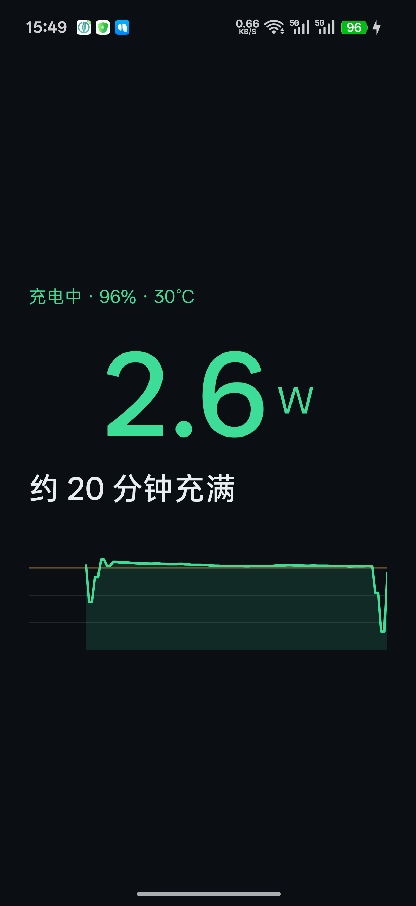
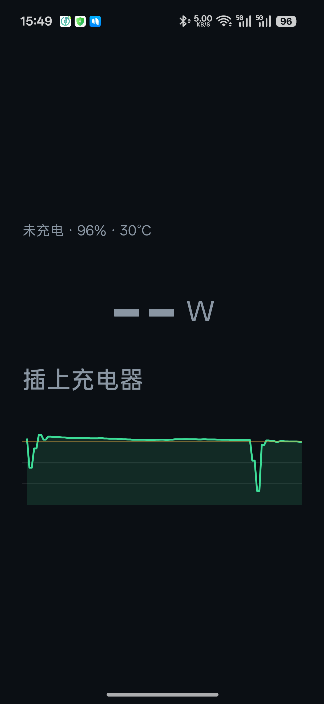
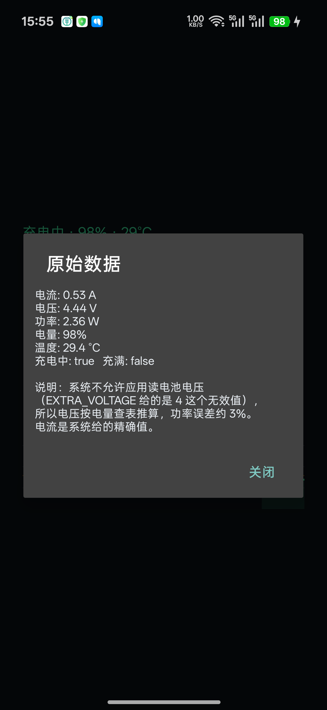

# 多少瓦 (ChargeScope)

**English** | [中文](README.md)

Plug in the charger and see the actual charging wattage (W) and how long until full.

## Supported device: OPPO Find X8s

**Tested on exactly one phone — OPPO Find X8s (Android 16). No other device has been tested, and none is supported.**

  
  
  

  Charging · unplugged · long-press the big number for raw readings

## Why build another charging app?

There are hundreds of charging apps already. Most of them want money or show ads — and on this phone most of them can't read the number at all. This one does a single thing: open it, get a real number, pay nothing, watch no ads. The whole source is public so you can adapt it in an afternoon instead of guessing for days.

## Install

Download the [latest APK](https://github.com/1c7/ChargeScope/releases/latest), copy it to your phone, tap install. You'll need to allow "install from unknown sources". Debug-signed, for personal use only.

Technical notes live in [`doc/`](doc/) — written in Chinese. Licensed under [MIT](LICENSE).

## Making it work on your phone (Huawei, Honor, Xiaomi, vivo, ...)

This code only reads battery data the OPPO way. Other vendors expose different interfaces, permissions and current units, so copying it as-is will mostly show nothing.

Hand the repo and [`doc/`](doc/) to your AI and have it re-measure on your device — faster than guessing yourself, and faster than waiting for someone else to port it.
